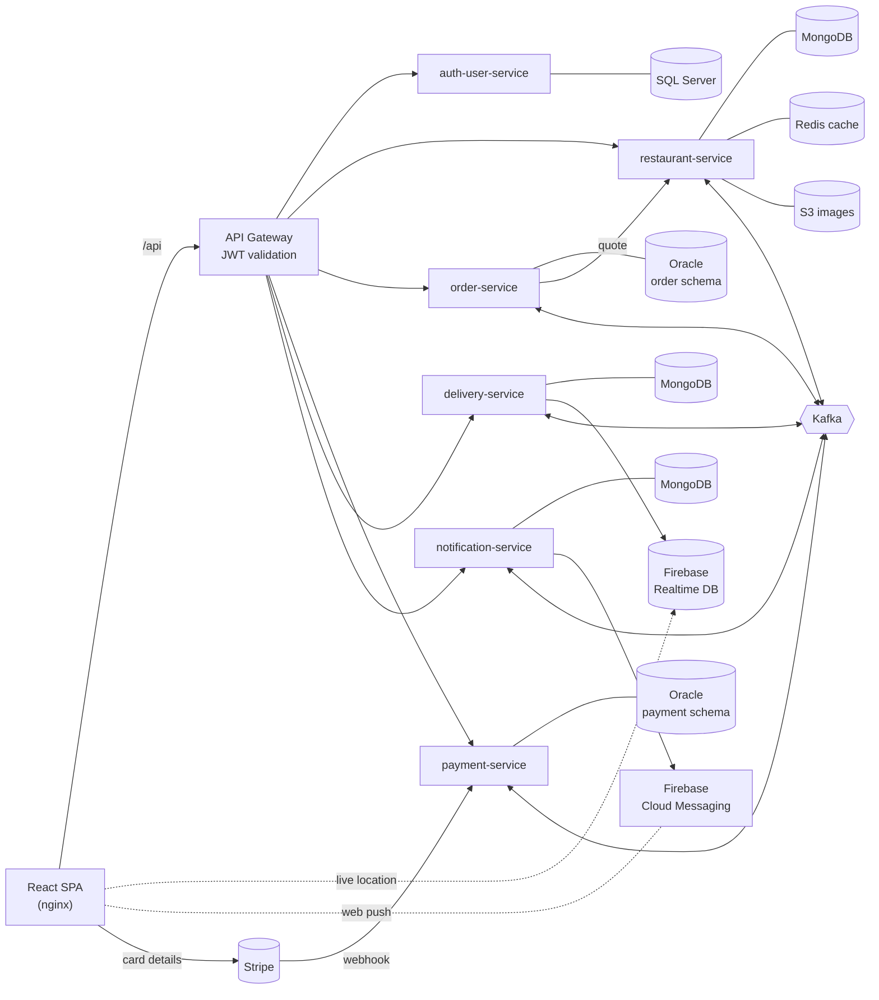
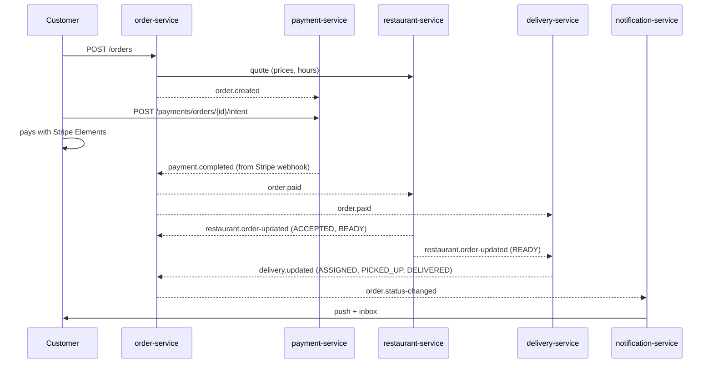
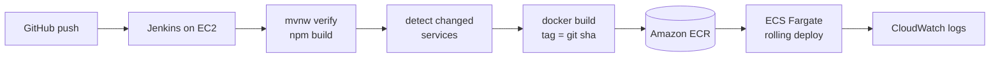

# DineDash

A cloud-native food delivery platform built as a set of Spring Boot microservices with a React frontend.
Customers order from nearby restaurants and track their driver live on a map, restaurants manage menus and
incoming orders, drivers get assigned automatically, and payments are handled by Stripe. Services talk to
each other through Kafka events and are deployed as containers on AWS with a Jenkins pipeline.

 
 
 


---

## Features

| Role | What they can do |
|---|---|
| **Customer** | Search restaurants by name or cuisine, sort by distance ("near me"), build a cart, check out with saved addresses, pay by card (Stripe), follow the order timeline, track the driver live on a map, get in-app and browser push notifications, cancel before the kitchen accepts |
| **Restaurant owner** | List restaurants (go live after admin approval), set hours, delivery fee and minimum order, manage the menu with photos, mark items sold out, pause orders, accept / reject / mark orders ready on a live kitchen screen |
| **Driver** | Set up a profile, go online and share location, get the nearest ready order assigned automatically, navigate to pickup and drop-off, confirm pickup and delivery |
| **Admin** | Daily order stats and revenue, approve or suspend restaurants, enable or disable users |

## Architecture



Each service owns its data (database per service) and uses the store that fits it best:

| Service | Port | Data store | Responsibility |
|---|---|---|---|
| `api-gateway` | 8080 | – | Single entry point (Spring Cloud Gateway). Validates JWTs, strips spoofed identity headers, forwards `X-User-*` headers, CORS, consistent JSON errors |
| `auth-user-service` | 8081 | SQL Server | Registration, login, rotating refresh tokens with reuse detection, profiles, delivery addresses, admin user management |
| `restaurant-service` | 8082 | MongoDB + Redis + S3 | Restaurants, menus, geo search (`2dsphere`), image uploads via pre-signed S3 URLs, kitchen order queue, admin approval |
| `order-service` | 8083 | Oracle | Cart checkout with server-side pricing, order state machine, status history, transactional outbox to Kafka |
| `payment-service` | 8084 | Oracle | Stripe PaymentIntents, signed webhooks as the source of truth, refunds on cancellation |
| `delivery-service` | 8085 | MongoDB + Firebase | Driver availability, nearest-driver assignment, trip flow, live location to Firebase |
| `notification-service` | 8086 | MongoDB + FCM | In-app inbox and browser push for every order update |

### Order lifecycle (event choreography)

No service calls another to move an order forward. Each one reacts to events on Kafka:



Topics: `order.created`, `order.paid`, `order.cancelled`, `order.status-changed`, `payment.completed`,
`payment.failed`, `restaurant.order-updated`, `delivery.updated`. Every message is keyed by order id so all
events of one order stay in order on one partition.

## Design decisions

- **Prices are never trusted from the browser.** `order-service` asks `restaurant-service` for an authoritative
  quote, and `payment-service` charges the amount it received in `order.created`.
- **Stripe webhooks decide if a payment succeeded,** not the frontend redirect. Webhooks are signature-checked and
  de-duplicated by event id. Events are published synchronously, so if Kafka is down the webhook fails and Stripe retries.
- **Transactional outbox in `order-service`.** Order changes and their events commit in one Oracle transaction and
  a relay publishes them, so an order can never change without its event.
- **Idempotent consumers.** Kafka delivery is at least once. Status transitions ignore duplicates, invalid or stale
  events are logged and skipped, and failing records are retried with backoff and then sent to a `.DLT` topic.
- **Safe driver assignment.** Claiming a driver is one atomic `findAndModify` (AVAILABLE → BUSY), so two orders can
  never get the same driver, even with several instances running.
- **Scoped live tracking.** The backend mints a Firebase custom token that can only read one order's node
  (`infra/firebase/database.rules.json`). Without Firebase, the map falls back to polling the REST API.
- **Least privilege.** Only `restaurant-service` has an AWS role (S3 `PutObject` on one prefix). Jenkins can only push
  to `dinedash/*` ECR repos and update ECS services. Secrets come from SSM Parameter Store or Kubernetes Secrets, never the repo.

## Caching

| Layer | What | How |
|---|---|---|
| Backend | Restaurant details and menus | Redis via Spring Cache, typed JSON, 10 min TTL, evicted on every owner or admin change, falls back to MongoDB if Redis is down |
| HTTP | Public catalog endpoints | `ETag` (304 Not Modified on repeat requests) and `Cache-Control: public, max-age=30, stale-while-revalidate=60` |
| Frontend | Server state | TanStack Query with per-query `staleTime`, menus prefetched on hover |
| Frontend | Repeat visits | Public catalog queries persisted to `localStorage` (1 h). Private data is never persisted and is cleared on logout |
| Static assets | JS/CSS bundles | Hashed file names served by nginx with `Cache-Control: immutable`, routes lazy-loaded |

## Tech stack

**Backend:** Java 21, Spring Boot 3.5, Spring Cloud Gateway, Spring Security, Spring Data JPA / MongoDB / Redis,
Spring Kafka, Flyway, JJWT, Stripe Java, Firebase Admin, AWS SDK v2 \
**Frontend:** React 19, TypeScript, Vite, Tailwind CSS, React Router, TanStack Query, Stripe Elements, Leaflet + OpenStreetMap, Firebase JS SDK \
**Data:** SQL Server, Oracle, MongoDB, Redis, Kafka (KRaft) \
**DevOps:** Docker, Docker Compose, Kubernetes (Kustomize, HPA, PDB, Ingress), Jenkins, AWS (ECR, ECS Fargate, S3, IAM, SSM, CloudWatch)

## Getting started

### Prerequisites

- JDK 21, Node 22, Docker (with Compose v2)
- Optional: Stripe test account, Firebase project, AWS account

### Run everything with Docker Compose

```bash
cp .env.example .env
# set at least JWT_SECRET (e.g. `openssl rand -base64 32`) and ADMIN_EMAIL / ADMIN_PASSWORD
docker compose up -d --build
```

| URL | What |
|---|---|
| http://localhost:3000 | Web app |
| http://localhost:8080 | API gateway |
| http://localhost:8090 | Kafka UI |

Oracle takes a minute or two to initialise on first start.

### Develop locally

```bash
# infrastructure only
docker compose up -d kafka mongodb redis oracle mssql mssql-init

# backend (each service in its own terminal)
export JWT_SECRET=...            # same value for gateway and auth-user-service
./mvnw -pl services/auth-user-service spring-boot:run

# frontend (proxies /api to the gateway on :8080)
cd frontend && npm install && npm run dev
```

To test payments locally, forward Stripe webhooks to the gateway:

```bash
stripe listen --forward-to localhost:8080/api/payments/webhooks/stripe
```

Use the test card `4242 4242 4242 4242` with any future expiry date and any CVC.

### Run on Kubernetes (minikube / kind)

```bash
cp infra/k8s/base/secrets.env.example infra/k8s/base/secrets.env   # fill in values
# build the images into the cluster, e.g. for minikube: eval $(minikube docker-env)
docker compose build
kubectl apply -k infra/k8s/overlays/local
echo "$(minikube ip) dinedash.local" | sudo tee -a /etc/hosts
```

The local overlay also deploys Kafka, MongoDB, Redis, Oracle and SQL Server as StatefulSets. In the cloud these are
replaced by managed services.

## CI/CD and AWS



- `Jenkinsfile`: tests every branch. On `main` it rebuilds only the components that changed (`ci/changed-services.sh`),
  pushes them to ECR and rolls them out with `infra/aws/scripts/deploy-ecs.sh`, waiting until the service is stable.
  The ECS deployment circuit breaker rolls back failed releases.
- `infra/aws/scripts/bootstrap-iam.sh`: IAM roles, S3 media bucket with CORS, ECR repositories.
- `infra/aws/scripts/register-task-definitions.sh` and `create-services.sh`: Fargate task definitions rendered from
  `infra/aws/ecs/services.json`, with services wired together by ECS Service Connect.

## Project structure

```
dinedash/
├── services/                 # Spring Boot microservices + shared Dockerfile
├── shared/dinedash-common/   # event contracts, security filter, error model
├── frontend/                 # React app + nginx config
├── infra/
│   ├── k8s/                  # base manifests, datastores, local overlay
│   ├── aws/                  # IAM policies, ECS task definitions, deploy scripts
│   ├── firebase/             # Realtime Database security rules
│   ├── oracle/, mssql/       # database init scripts for compose
├── ci/                       # pipeline helper scripts
├── docker-compose.yml
└── Jenkinsfile
```

## Testing

```bash
./mvnw verify                     # unit tests for all services
cd frontend && npm run lint && npm run build
```

Tests cover pricing and minimum order rules, the order state machine, refund and cancellation paths, JWT and
refresh token rotation, gateway header stripping and admin route protection, driver trip rules, S3 key scoping
and cache eviction.

## Author

**Nandun Perera** · [GitHub](https://github.com/Nandun99)
